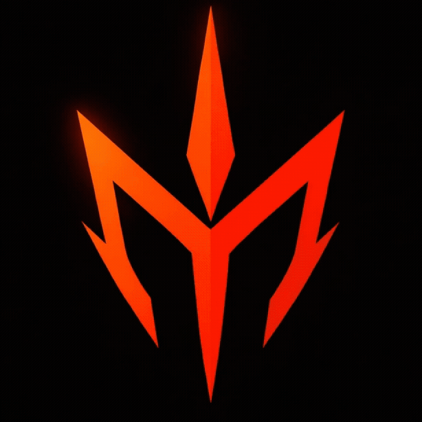

  

<!-- ═══════════ RED-X CORPORATION — Professional README ═══════════ -->

<!-- Animated Title -->

  

<!-- Badges -->

  
  

## About Us  

**RED-X CORPORATION** is a next-generation engineering team creating professional tools for gaming, automation, and modern software.  
This GITHUB profile is fully managed by Mohtasim Billah Jitu.

**Focus Areas**  
- Reverse & Memory Engineering  
- Memory manipulation
- Game Cheats💀

**Leadership & Team**  
- Mohtasim Billah Jitu — Founder & CEO  
- Jubayer — Developer & Admin  
- Ashik — Social Media & Client Handler  
- Abid — Marketer & Client Handler  

We build with **precision, reliability, and design** — turning complexity into innovation.  
 

## Skills & Tools  

  

## Insights  

  *Stats below reflect the activity of mohtasimjitu & RED-X CORPORATION repositories on GitHub.*  

  
  

   
   

<!--

  

-->
<!-- Snake Game Repo View -->

<!-- Badges 

  

-->

## Contribution Calendar  

  

## Contact & Links  

  
  
  

---

**RED-X CORPORATION** — Precision Engineering • Professional Tools • Zero Fluff  

<!-- ════════════════════════════════════════════════════════════════ -->
